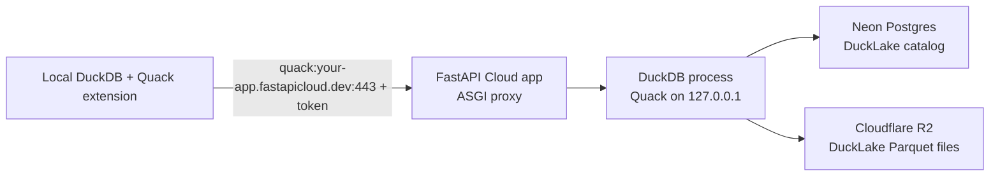

# FastAPI Cloud, Neon, and R2

NeoQuack runs DuckDB remotely.

Local DuckDB connects to it with Quack.

DuckLake stores metadata in Neon Postgres and data files in Cloudflare R2.

## Run It

Before you run it, install or authenticate:

- Python 3.13
- `uv`
- `npx`
- `duckdb` CLI v1.5.2
- `curl`
- FastAPI Cloud login
- Neon login
- Cloudflare Wrangler login

Use one command:

```sh
./scripts/deploy-fastapi-cloud.sh
```

The command is safe to run again.

It creates or reuses Neon, confirms the configured R2 bucket, sets FastAPI Cloud secrets, deploys, and validates when `QUACK_HTTP_URL` is set.

On a fresh machine, the first run can stop after it creates `.neoquack/object-store.env`. Fill in the R2 S3 key fields, then run the same command again.

If Wrangler can see more than one Cloudflare account, set one of these first:

```sh
export NEOQUACK_R2_ACCOUNT_ID='your-cloudflare-account-id'
# or
export CLOUDFLARE_ACCOUNT_ID='your-cloudflare-account-id'
```

FastAPI Cloud can still deploy the app successfully while public Quack validation fails. If validation stops with a multi-instance routing message, the app is running but the public URL is not production-safe for Quack until FastAPI Cloud provides sticky routing or single-runtime placement for this app.

## Status

| Check | Status |
| --- | --- |
| FastAPI Cloud deployment | running |
| Local infrastructure proof | passing with `./scripts/validate-local.sh` |
| Public Quack production-ready | requires `./scripts/validate-fastapi-cloud.sh` to pass against `QUACK_HTTP_URL` |
| Current blocker | FastAPI Cloud public routing reaches multiple runtime replicas |

`./scripts/validate-local.sh` proves the same Neon/R2/runtime configuration on one local instance, but it does not clear the public-routing blocker.

## R2 Keys

The local keys file is:

```text
.neoquack/object-store.env
```

Create the S3 API token in the dashboard:

R2 Object Storage > Overview > Account Details > API Tokens > Manage.

Do not look for this from an individual bucket settings page.

The bucket Settings > General page shows the S3 API endpoint:

```text
https://your-account-id.r2.cloudflarestorage.com/neoquack-ducklake
```

For DuckDB `TYPE r2`, NeoQuack uses the account id and bucket path from `.neoquack/object-store.env`; it does not need the full endpoint URL.

Fill only these values:

```sh
NEOQUACK_R2_ACCESS_KEY_ID='replace-me-r2-access-key-id'
NEOQUACK_R2_SECRET_ACCESS_KEY='replace-me-r2-secret-access-key'
```

## Try It

After deployment, set the app URL:

```sh
export QUACK_HTTP_URL=https://your-app.fastapicloud.dev
```

Use the URL printed by FastAPI Cloud deploy or the app domain shown in the FastAPI Cloud dashboard.

Load the generated Quack token:

```sh
. ./.neoquack/fastapi-cloud.env
```

Then validate:

```sh
./scripts/validate-fastapi-cloud.sh
```

If public validation stops at the routing preflight, run the single-runtime proof:

```sh
./scripts/validate-local.sh
```

That local proof is useful for Neon, R2, DuckLake, and Quack runtime changes. Public production success still requires `./scripts/validate-fastapi-cloud.sh` to pass against `QUACK_HTTP_URL`.

Use [FastAPI Cloud routing issue handoff](fastapi-cloud-routing-issue.md) when opening an issue with FastAPI Cloud.

## Connect From DuckDB

```sql
FORCE INSTALL quack FROM core_nightly;
LOAD quack;

CREATE OR REPLACE SECRET neoquack_remote (
    TYPE quack,
    SCOPE 'quack:your-app.fastapicloud.dev:443',
    TOKEN 'token-from-.neoquack/fastapi-cloud.env'
);

ATTACH 'quack:your-app.fastapicloud.dev:443' AS remote (TYPE quack);

FROM remote.query('FROM whoami()');
FROM remote.query('SELECT * FROM ducklake_settings(''neoquack'')');
```

## How It Works



FastAPI Cloud runs `main:app`, a small root import shim that loads `src/neoquack_server/app.py`.

That app starts the DuckDB/Quack runtime in a background thread, exposes `/healthz` and `/readyz`, and proxies Quack traffic to the local Quack listener with a persistent upstream client. The proxy clamps the upstream pool to one connection because Quack connection ids need upstream affinity; timeout values remain parameterized with `NEOQUACK_PROXY_*` env vars.

DuckLake is attached like this:

```sql
ATTACH 'ducklake:postgres:dbname=<database> host=<host> port=5432 user=<role> sslmode=require'
AS neoquack (
    DATA_PATH 'r2://neoquack-ducklake/data/',
    META_SECRET 'neoquack_pg_catalog',
    AUTOMATIC_MIGRATION false,
    OVERRIDE_DATA_PATH false
);
```

`OVERRIDE_DATA_PATH false` prevents a changed environment variable from silently pointing an existing DuckLake catalog at a different object-store prefix.

`AUTOMATIC_MIGRATION false` keeps normal multi-instance startup from mutating the shared DuckLake catalog during gradual deployments. Run catalog migrations deliberately, or set `NEOQUACK_DUCKLAKE_AUTOMATIC_MIGRATION=1` only for a controlled single-runtime maintenance window.

## Values Sent To FastAPI Cloud

| Name | Source | Secret |
| --- | --- | --- |
| `DATABASE_URL` | `.neoquack/neon.env` | yes |
| `NEOQUACK_QUACK_TOKEN` | `.neoquack/fastapi-cloud.env` | yes |
| `NEOQUACK_OBJECT_STORE` | `.neoquack/object-store.env` | no |
| `NEOQUACK_DUCKLAKE_DATA_PATH` | `.neoquack/object-store.env` | no |
| `NEOQUACK_R2_ACCOUNT_ID` | `.neoquack/object-store.env` | no |
| `NEOQUACK_R2_ACCESS_KEY_ID` | `.neoquack/object-store.env` | yes |
| `NEOQUACK_R2_SECRET_ACCESS_KEY` | `.neoquack/object-store.env` | yes |
| `NEOQUACK_RUNTIME_PROVIDER` | `.neoquack/fastapi-cloud.env` | no |
| `NEOQUACK_REGION` | `.neoquack/fastapi-cloud.env` | no |

`setup-fastapi-cloud-env.sh` validates object-store placeholders before publishing cloud env vars and uses the FastAPI Cloud API to create or update env vars in place. It only deletes and recreates a variable when the secret/plain classification needs to change.

## Manual Stages

```sh
./scripts/setup-neon.sh
./scripts/setup-r2.sh
./scripts/setup-object-store-env.sh
./scripts/setup-fastapi-cloud-env.sh
uv run --python 3.13 fastapi deploy
```

`setup-fastapi-cloud-env.sh` runs a bootstrap `fastapi deploy --no-wait` when `.fastapicloud/` does not exist yet, because the FastAPI Cloud CLI needs an app link before env vars can be set.

## Validation

`validate-fastapi-cloud.sh` checks:

- health and readiness endpoints
- single-instance/sticky routing for Quack connection affinity
- authenticated Quack attach
- wrong-token rejection
- rollback and commit behavior through Quack
- two concurrent large fetches through the proxy
- a 10,000-row fetch through Quack
- DuckLake writes through Neon and R2
- DuckLake catalog data path drift
- direct object-store reads for fresh DuckLake files
- FastAPI Cloud logs for literal secret values when logs are available

Validation tables and marker rows are removed at the end of a successful run. Set `NEOQUACK_KEEP_VALIDATION_ARTIFACTS=1` only when you need to inspect those artifacts after validation.

## FastAPI Cloud Routing Constraint

FastAPI Cloud automatically scales replicas and uses gradual deployments. That is a good default for stateless APIs, but Quack keeps `quack_connection_id` state on the server-side HTTP connection. If the public FastAPI Cloud URL routes consecutive Quack requests to different runtime instances, DuckDB returns `Invalid connection id`.

The validation script detects this by sampling `/healthz` and comparing non-secret `instance_id` values. If more than one instance answers, configure FastAPI Cloud for sticky routing or a single runtime instance before exposing Quack through this URL. Until that setting is available, the same NeoQuack runtime can still be validated locally against Neon and R2, but the public FastAPI Cloud Quack protocol path is not production-safe.

This affects attached Quack catalogs and can also affect `quack_query()` calls. In the current app, a public `quack_query()` probe can return one result and then fail on a later request with `Invalid connection id`, because the protocol still needs follow-up requests to reach the same server-side Quack state.

The repeatable local proof is:

```sh
./scripts/validate-local.sh
```

That script starts one local ASGI runtime with the same ignored `.neoquack/` Neon and R2 values, runs the full Quack/DuckLake validator against `127.0.0.1`, and stops the local server afterward.

Last checked on May 16, 2026 for the `neoquack` app/account: the FastAPI Cloud CLI and authenticated OpenAPI surface expose app CRUD, deployments, environment variables, logs, read-only metrics paths, domains, integrations, and tokens, but no scriptable replica-count or sticky-routing setting. The app update schema only accepts `directory`, and the metrics paths returned `404` for this app. The authenticated dashboard was also checked: the app sidebar exposes Deployments, Logs, Environment Variables, Storage, Tokens, and Settings; the Settings page exposes Region, Application Directory, Transfer App, and Delete App, but no replica or sticky-routing control. Treat the routing preflight failure as a platform configuration blocker, not a DuckLake, Neon, R2, or Quack runtime failure.

References:

- [FastAPI Cloud: How It Works](https://fastapicloud.com/docs/builds-and-deployments/how-it-works/)
- [FastAPI Cloud: Metrics and Replicas](https://fastapicloud.com/docs/monitoring-and-performance/metrics/)
- [DuckDB: Securing Quack with a Reverse Proxy](https://duckdb.org/docs/current/quack/setup/reverse_proxy)
- [DuckDB: Quack Remote Protocol](https://duckdb.org/docs/current/quack/overview)

## DuckDB And Quack Versions

NeoQuack pins DuckDB `1.5.2`.

The Quack extension is currently loaded from `core_nightly`, because Quack is still a beta DuckDB extension. The runtime uses `INSTALL` by default and only force-refreshes extensions when `NEOQUACK_FORCE_INSTALL_EXTENSIONS=1` is set.

## Local Secret State

These paths are ignored by git:

- `.neoquack/`
- `.neon`
- `.fastapicloud/`
- `.wrangler/`

## Handoff Checklist

- App URL: use the FastAPI Cloud deploy output or dashboard domain.
- Public validation: run `QUACK_HTTP_URL=<app-url> ./scripts/validate-fastapi-cloud.sh`.
- Local single-runtime proof: run `./scripts/validate-local.sh`.
- Known blocker: public Quack is not production-ready while FastAPI Cloud routes requests across multiple runtime replicas.
- Secret locations: `.neoquack/fastapi-cloud.env`, `.neoquack/neon.env`, and `.neoquack/object-store.env`; hand off names and storage location, not values.
- Logs: use `uv run --python 3.13 fastapi cloud logs --no-follow --tail 200`.
